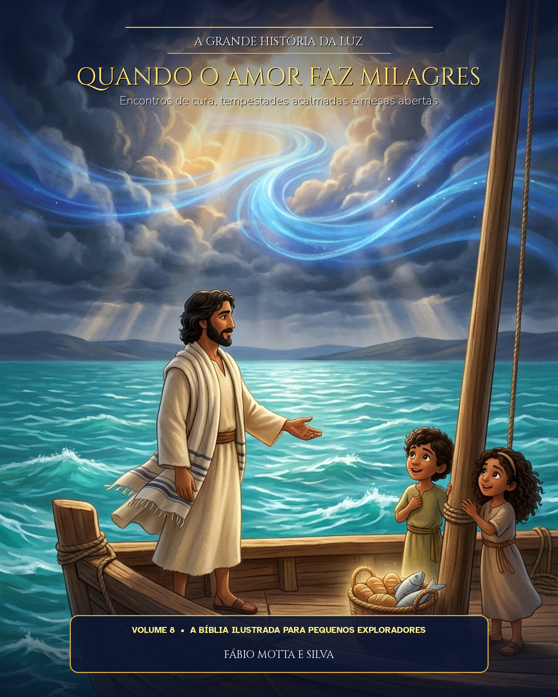
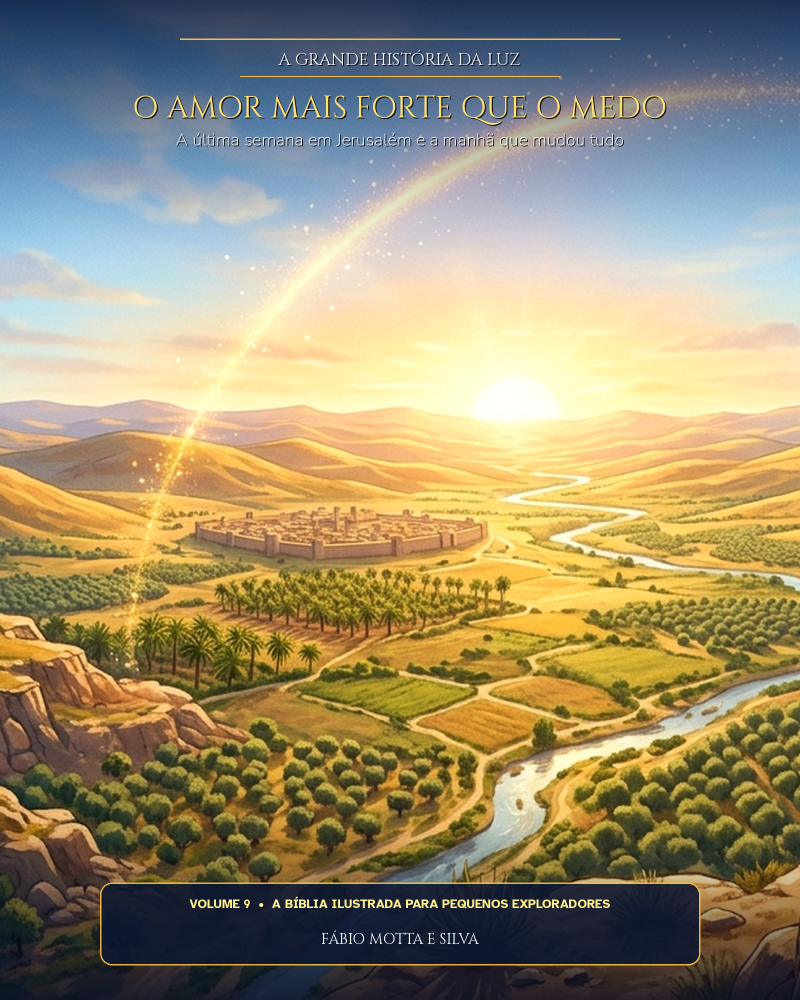
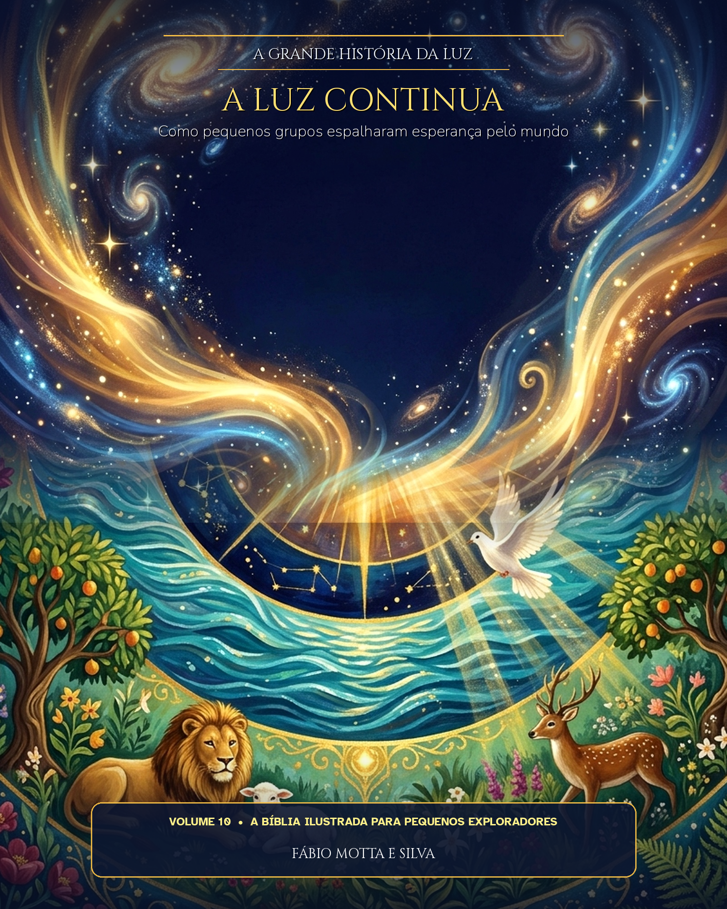

# ✨ A Grande História da Luz — A Bíblia Ilustrada para Pequenos Exploradores

**Autor:** Fábio Motta e Silva *(Publicação Independente / Autônoma)*  
**Escopo Canônico Completo:** Toda a História Bíblica de **Gênesis ao Apocalipse** em **10 Volumes Ilustrados (240 Páginas Diagramadas + 640 Páginas de Roteiros e Storyboards)**  
**Público-Alvo:** Crianças de 4 a 10 anos e suas famílias (Sistema de Leitura em Dupla Camada: *Camada Semente 4–6 anos* & *Camada Explorador 6–10 anos*)  
**Direção de Arte:** Animação Cinematográfica 3D Autoral + Textura Artesanal • Regra Teológica **Fiat Lux** (Presença Divina representada exclusivamente por feixes volumétricos de luz dourada e azul-safira, sem antropomorfismo do Pai) • Reconstrução Histórica e Arqueológica do Oriente Próximo e de Jesus Histórico do Século I (Galileia/Judeia).  
**Padrão Editorial dos Livros Diagramados:** **24 páginas completas por volume** (`1600 × 2000 px` digital 200 DPI / `2438 × 3075 px` impressão gráfica 300 DPI com sangria de 3 mm — padrão oficial Amazon KDP Print & KDP Kids) + **Edição Integral Unificada de 240 Páginas**.

---

## 🌟 Edição Integral Unificada — Toda a História Bíblica (Volumes 1 a 10 • 240 Páginas)

| Edição | Conteúdo Canônico | Total de Páginas | Kindle KDP (EPUB 3) | Hotmart / Digital (PDF HD) |
| :---: | :--- | :---: | :---: | :---: |
| **Coleção Completa (Omnibus Vol. 1 a 10)** | **Toda a Bíblia Ilustrada (Gênesis ao Apocalipse):** Criação, Patriarcas, Êxodo, Juízes, Reis, Profetas, Evangelhos (Infância, Parábolas, Milagres, Páscoa de Jesus), Atos dos Apóstolos e Nova Criação (60 capítulos em dupla camada 4–10 anos) | **240 págs.** | [📥 EPUB 3 Edição Integral (240p)](11-Exportacoes-Kindle/A_Grande_Historia_da_Luz_Colecao_Completa_Vol1_a_10_240Paginas_KDP.epub) | [📥 PDF HD Edição Integral (240p)](12-Exportacoes-Hotmart/A_Grande_Historia_da_Luz_Colecao_Completa_Vol1_a_10_240Paginas_HD.pdf) |

---

## 📚 Os 10 Volumes Individuais da Coleção (24 Páginas Diagramadas por Volume)

### Antigo Testamento (Volumes 1 a 5 — 120 Páginas Diagramadas)

| Volume | Título e Recorte Bíblico | Páginas | Kindle KDP (EPUB 3) | Hotmart / Digital (PDF HD) | Gráfica / KDP Print (300 DPI) | Roteiro & Storyboard (64 págs.) |
| :---: | :--- | :---: | :---: | :---: | :---: | :---: |
| **Vol. 1** | **Faça-se a Luz** *O começo de todas as histórias* (Gênesis 1 a 11: Criação, Éden, Caim e Abel, Arca de Noé e Babel) | **24 págs.** | [📥 EPUB 3](11-Exportacoes-Kindle/A_Grande_Historia_da_Luz_Vol1_FixedLayout_KDP.epub) | [📥 PDF HD](12-Exportacoes-Hotmart/A_Grande_Historia_da_Luz_Vol1_Piloto_HD.pdf) | [📥 PDF 300 DPI](13-Edicao-Impressa/A_Grande_Historia_da_Luz_Vol1_Print_300DPI_Bleed.pdf) | [📄 Roteiro Vol. 1](06-Roteiros/Entrega4_Roteiro_Completo_Volume1.md) [📐 Storyboard 64p](07-Storyboards/Entrega5_Storyboard_Editorial_64Paginas.md) |
| **Vol. 2** | **As Estrelas da Promessa** *Os amigos que caminharam olhando para o céu* (Gênesis 12 a 50: Abraão, Sara, Isaque, Jacó e José no Egito) | **24 págs.** | [📥 EPUB 3](11-Exportacoes-Kindle/A_Grande_Historia_da_Luz_Vol2_FixedLayout_KDP.epub) | [📥 PDF HD](12-Exportacoes-Hotmart/A_Grande_Historia_da_Luz_Vol2_Piloto_HD.pdf) | [📥 PDF 300 DPI](13-Edicao-Impressa/A_Grande_Historia_da_Luz_Vol2_Print_300DPI_Bleed.pdf) | [📄 Roteiro & Storyboard Vol. 2](15-Volumes-Futuros/Volume2_As_Estrelas_da_Promessa_Roteiro_e_Storyboard.md) |
| **Vol. 3** | **O Caminho da Liberdade** *O príncipe do Nilo e a travessia do deserto* (Êxodo a Deuteronômio: Moisés, Miriã, Páscoa, Mar Vermelho e Sinai) | **24 págs.** | [📥 EPUB 3](11-Exportacoes-Kindle/A_Grande_Historia_da_Luz_Vol3_FixedLayout_KDP.epub) | [📥 PDF HD](12-Exportacoes-Hotmart/A_Grande_Historia_da_Luz_Vol3_Piloto_HD.pdf) | [📥 PDF 300 DPI](13-Edicao-Impressa/A_Grande_Historia_da_Luz_Vol3_Print_300DPI_Bleed.pdf) | [📄 Roteiro & Storyboard Vol. 3](15-Volumes-Futuros/Volume3_O_Caminho_da_Liberdade_Roteiro_e_Storyboard.md) |
| **Vol. 4** | **Coragem para Mudar o Mundo** *Juízes, Rute, Samuel e o jovem pastor Davi* (Josué a 2 Samuel: Jericó, Débora, Gideão, Rute, Samuel e Davi) | **24 págs.** | [📥 EPUB 3](11-Exportacoes-Kindle/A_Grande_Historia_da_Luz_Vol4_FixedLayout_KDP.epub) | [📥 PDF HD](12-Exportacoes-Hotmart/A_Grande_Historia_da_Luz_Vol4_Piloto_HD.pdf) | [📥 PDF 300 DPI](13-Edicao-Impressa/A_Grande_Historia_da_Luz_Vol4_Print_300DPI_Bleed.pdf) | [📄 Roteiro & Storyboard Vol. 4](15-Volumes-Futuros/Volume4_Coragem_para_Mudar_o_Mundo_Roteiro_e_Storyboard.md) |
| **Vol. 5** | **Vozes de Sabedoria e Esperança** *Salmos, Reis, Profetas e a Promessa da Luz* (1 Reis a Malaquias: Salomão, Elias, Jonas, Isaías, Daniel, Ester e Neemias) | **24 págs.** | [📥 EPUB 3](11-Exportacoes-Kindle/A_Grande_Historia_da_Luz_Vol5_FixedLayout_KDP.epub) | [📥 PDF HD](12-Exportacoes-Hotmart/A_Grande_Historia_da_Luz_Vol5_Piloto_HD.pdf) | [📥 PDF 300 DPI](13-Edicao-Impressa/A_Grande_Historia_da_Luz_Vol5_Print_300DPI_Bleed.pdf) | [📄 Roteiro & Storyboard Vol. 5](15-Volumes-Futuros/Volume5_Vozes_de_Sabedoria_e_Esperanca_Roteiro_e_Storyboard.md) |

### Novo Testamento (Volumes 6 a 10 — 120 Páginas Diagramadas)

| Volume | Título e Recorte Bíblico | Páginas | Kindle KDP (EPUB 3) | Hotmart / Digital (PDF HD) | Gráfica / KDP Print (300 DPI) | Roteiro & Storyboard (64 págs.) |
| :---: | :--- | :---: | :---: | :---: | :---: | :---: |
| **Vol. 6** | **Uma Luz Nasce no Mundo** *A chegada de Jesus e os primeiros passos na Galileia* (Anunciação, Belém, Pastores, Magos, Nazaré, Batismo e Primeiros Discípulos) | **24 págs.** | [📥 EPUB 3](11-Exportacoes-Kindle/A_Grande_Historia_da_Luz_Vol6_FixedLayout_KDP.epub) | [📥 PDF HD](12-Exportacoes-Hotmart/A_Grande_Historia_da_Luz_Vol6_Piloto_HD.pdf) | [📥 PDF 300 DPI](13-Edicao-Impressa/A_Grande_Historia_da_Luz_Vol6_Print_300DPI_Bleed.pdf) | [📄 Roteiro & Storyboard Vol. 6](15-Volumes-Futuros/Volume6_Uma_Luz_Nasce_no_Mundo_Roteiro_e_Storyboard.md) |
| **Vol. 7** | **As Histórias que Jesus Contou** *Sermão do Monte e Parábolas do Reino* (Bem-Aventuranças, Semeador, Bom Samaritano, Ovelha Perdida, Filho Pródigo e Casa na Rocha) | **24 págs.** | [📥 EPUB 3](11-Exportacoes-Kindle/A_Grande_Historia_da_Luz_Vol7_FixedLayout_KDP.epub) | [📥 PDF HD](12-Exportacoes-Hotmart/A_Grande_Historia_da_Luz_Vol7_Piloto_HD.pdf) | [📥 PDF 300 DPI](13-Edicao-Impressa/A_Grande_Historia_da_Luz_Vol7_Print_300DPI_Bleed.pdf) | [📄 Roteiro & Storyboard Vol. 7](15-Volumes-Futuros/Volume7_As_Historias_que_Jesus_Contou_Roteiro_e_Storyboard.md) |
| **Vol. 8** | **Quando o Amor Faz Milagres** *Encontros de cura, partilha e compaixão* (Tempestade Acalmada, Pães e Peixes, Bartimeu, Jairo, Jesus e as Crianças, Zaqueu) | **24 págs.** | [📥 EPUB 3](11-Exportacoes-Kindle/A_Grande_Historia_da_Luz_Vol8_FixedLayout_KDP.epub) | [📥 PDF HD](12-Exportacoes-Hotmart/A_Grande_Historia_da_Luz_Vol8_Piloto_HD.pdf) | [📥 PDF 300 DPI](13-Edicao-Impressa/A_Grande_Historia_da_Luz_Vol8_Print_300DPI_Bleed.pdf) | [📄 Roteiro & Storyboard Vol. 8](15-Volumes-Futuros/Volume8_Quando_o_Amor_Faz_Milagres_Roteiro_e_Storyboard.md) |
| **Vol. 9** | **O Amor Mais Forte que o Medo** *A Semana Santa, a Cruz e a Manhã da Páscoa* (Entrada em Jerusalém, Lava-Pés, Cruz, Ressurreição, Emaús e Café na Praia) | **24 págs.** | [📥 EPUB 3](11-Exportacoes-Kindle/A_Grande_Historia_da_Luz_Vol9_FixedLayout_KDP.epub) | [📥 PDF HD](12-Exportacoes-Hotmart/A_Grande_Historia_da_Luz_Vol9_Piloto_HD.pdf) | [📥 PDF 300 DPI](13-Edicao-Impressa/A_Grande_Historia_da_Luz_Vol9_Print_300DPI_Bleed.pdf) | [📄 Roteiro & Storyboard Vol. 9](15-Volumes-Futuros/Volume9_O_Amor_Mais_Forte_que_o_Medo_Roteiro_e_Storyboard.md) |
| **Vol. 10** | **A Luz Continua** *Os primeiros cristãos e o Jardim da Nova Criação* (Atos dos Apóstolos a Apocalipse 21–22: Pentecostes, Paulo, Lídia, Armadura da Luz e Árvore da Vida) | **24 págs.** | [📥 EPUB 3](11-Exportacoes-Kindle/A_Grande_Historia_da_Luz_Vol10_FixedLayout_KDP.epub) | [📥 PDF HD](12-Exportacoes-Hotmart/A_Grande_Historia_da_Luz_Vol10_Piloto_HD.pdf) | [📥 PDF 300 DPI](13-Edicao-Impressa/A_Grande_Historia_da_Luz_Vol10_Print_300DPI_Bleed.pdf) | [📄 Roteiro & Storyboard Vol. 10](15-Volumes-Futuros/Volume10_A_Luz_Continua_Roteiro_e_Storyboard.md) |

---

## 🎨 Galeria das 10 Capas Oficiais (Estilo 2 — Aventura Infantil Cinematográfica 3D)

### Volumes 1 a 5 (Antigo Testamento)
| Vol. 1 — *Faça-se a Luz* | Vol. 2 — *As Estrelas da Promessa* | Vol. 3 — *O Caminho da Liberdade* | Vol. 4 — *Coragem para Mudar o Mundo* | Vol. 5 — *Vozes de Sabedoria e Esperança* |
| :---: | :---: | :---: | :---: | :---: |
|  |  |  |  |  |

### Volumes 6 a 10 (Novo Testamento)
| Vol. 6 — *Uma Luz Nasce no Mundo* | Vol. 7 — *As Histórias que Jesus Contou* | Vol. 8 — *Quando o Amor Faz Milagres* | Vol. 9 — *O Amor Mais Forte que o Medo* | Vol. 10 — *A Luz Continua* |
| :---: | :---: | :---: | :---: | :---: |
|  |  |  |  |  |

---

## 👥 Bíblia de Personagens e Reconstrução Histórica (Oriente Próximo & Século I)

- **Adão e Eva (Volume 1):** [char_sheet_adao_eva.jpg](04-Biblia-de-Personagens/char_sheet_adao_eva.jpg)
- **Noé e Naamá (Volume 1):** [char_sheet_noe_familia.jpg](04-Biblia-de-Personagens/char_sheet_noe_familia.jpg)
- **Abraão, Sara e José (Volumes 2 e 4):** [char_sheet_abraao_sara_jose.jpg](04-Biblia-de-Personagens/char_sheet_abraao_sara_jose.jpg)
- **Miriã e Moisés (Volumes 3 e 5):** [char_sheet_moises_miriam.jpg](04-Biblia-de-Personagens/char_sheet_moises_miriam.jpg)
- **Jesus de Nazaré — Reconstrução Histórica do Século I (Volumes 6 a 10):** [char_sheet_jesus_historico.jpg](04-Biblia-de-Personagens/char_sheet_jesus_historico.jpg)

---

© **Fábio Motta e Silva** — Publicação Independente / Autônoma. Todos os direitos reservados.
