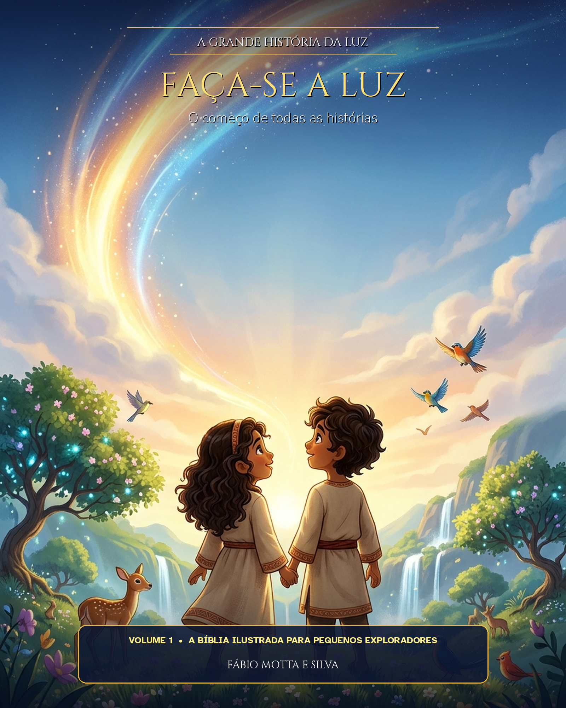
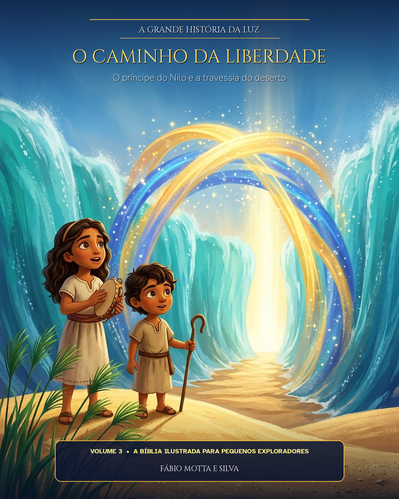

# ✨ A Grande História da Luz — A Bíblia Ilustrada para Pequenos Exploradores

**Autor:** Fábio Motta e Silva *(Publicação Independente / Autônoma)*  
**Público-Alvo:** Crianças de 4 a 10 anos e suas famílias (Sistema de Leitura em Dupla Camada: *Camada Semente 4–6 anos* & *Camada Explorador 6–10 anos*)  
**Direção de Arte:** Animação Cinematográfica 3D Autoral + Textura Artesanal • Regra Teológica **Fiat Lux** (Presença Divina representada exclusivamente por feixes volumétricos de luz dourada e azul-safira, sem antropomorfismo de Deus) • Reconstrução Histórica e Arqueológica Levantina/Oriente Próximo.  
**Padrão Editorial dos Livros Diagramados:** **24 páginas completas por volume** (`1600 × 2000 px` digital 200 DPI / `2438 × 3075 px` impressão gráfica 300 DPI com sangria de 3 mm — padrão oficial Amazon KDP Print & KDP Kids) + **Roteiros e Storyboards Expandidos de 64 páginas por volume**.

---

## 📚 Trilogia Inicial Concluída (Pentateuco — Volumes 1, 2 e 3)

| Volume | Título e Recorte Bíblico | Páginas Diagramadas | Kindle KDP (EPUB 3) | Hotmart / Digital (PDF HD) | Gráfica / KDP Print (300 DPI + Bleed) | Roteiro & Storyboard (64 págs.) |
| :---: | :--- | :---: | :---: | :---: | :---: | :---: |
| **Vol. 1** | **Faça-se a Luz** *O começo de todas as histórias* (Gênesis 1 a 11: Criação, Éden, Caim e Abel, Arca de Noé e Babel) | **24 págs.** | [📥 EPUB 3 KDP](11-Exportacoes-Kindle/A_Grande_Historia_da_Luz_Vol1_FixedLayout_KDP.epub) | [📥 PDF HD](12-Exportacoes-Hotmart/A_Grande_Historia_da_Luz_Vol1_Piloto_HD.pdf) | [📥 PDF Print 300 DPI](13-Edicao-Impressa/A_Grande_Historia_da_Luz_Vol1_Print_300DPI_Bleed.pdf) | [📄 Roteiro Vol. 1](06-Roteiros/Entrega4_Roteiro_Completo_Volume1.md) [📐 Storyboard 64p](07-Storyboards/Entrega5_Storyboard_Editorial_64Paginas.md) |
| **Vol. 2** | **As Estrelas da Promessa** *Os amigos que caminharam olhando para o céu* (Gênesis 12 a 50: Abraão, Sara, Isaque, Jacó e José no Egito) | **24 págs.** | [📥 EPUB 3 KDP](11-Exportacoes-Kindle/A_Grande_Historia_da_Luz_Vol2_FixedLayout_KDP.epub) | [📥 PDF HD](12-Exportacoes-Hotmart/A_Grande_Historia_da_Luz_Vol2_Piloto_HD.pdf) | [📥 PDF Print 300 DPI](13-Edicao-Impressa/A_Grande_Historia_da_Luz_Vol2_Print_300DPI_Bleed.pdf) | [📄 Roteiro & Storyboard Vol. 2](15-Volumes-Futuros/Volume2_As_Estrelas_da_Promessa_Roteiro_e_Storyboard.md) |
| **Vol. 3** | **O Caminho da Liberdade** *O príncipe do Nilo e a travessia do deserto* (Êxodo a Deuteronômio: Moisés, Miriã, Páscoa, Mar Vermelho, Sinai e Monte Nebo) | **24 págs.** | [📥 EPUB 3 KDP](11-Exportacoes-Kindle/A_Grande_Historia_da_Luz_Vol3_FixedLayout_KDP.epub) | [📥 PDF HD](12-Exportacoes-Hotmart/A_Grande_Historia_da_Luz_Vol3_Piloto_HD.pdf) | [📥 PDF Print 300 DPI](13-Edicao-Impressa/A_Grande_Historia_da_Luz_Vol3_Print_300DPI_Bleed.pdf) | [📄 Roteiro & Storyboard Vol. 3](15-Volumes-Futuros/Volume3_O_Caminho_da_Liberdade_Roteiro_e_Storyboard.md) |

---

## 🎨 Galeria das Capas Oficiais (Estilo 2 — Aventura Infantil Cinematográfica 3D)

| Volume 1 — *Faça-se a Luz* | Volume 2 — *As Estrelas da Promessa* | Volume 3 — *O Caminho da Liberdade* |
| :---: | :---: | :---: |
|  |  |  |

---

## 👥 Bíblia de Personagens e Reconstrução Histórica (Oriente Próximo)

- **Adão e Eva (Volume 1):** [char_sheet_adao_eva.jpg](04-Biblia-de-Personagens/char_sheet_adao_eva.jpg)
- **Noé e Naamá (Volume 1):** [char_sheet_noe_familia.jpg](04-Biblia-de-Personagens/char_sheet_noe_familia.jpg)
- **Abraão, Sara e José (Volume 2):** [char_sheet_abraao_sara_jose.jpg](04-Biblia-de-Personagens/char_sheet_abraao_sara_jose.jpg)
- **Miriã e Moisés (Volume 3):** [char_sheet_moises_miriam.jpg](04-Biblia-de-Personagens/char_sheet_moises_miriam.jpg)
- **Jesus de Nazaré — Reconstrução Histórica do Século I (Prévia Volumes 7–9):** [char_sheet_jesus_historico.jpg](04-Biblia-de-Personagens/char_sheet_jesus_historico.jpg)

---

## 🗂️ Estrutura Completa do Repositório Editorial

- `00-Direcao-Editorial/` — Documento Editorial Mestre da Coleção (10 Volumes)
- `03-Identidade-Visual/` — Capas Oficiais, Prancha Comparativa 120px e Fontes Open-Source (`Cinzel`, `Nunito`, `Atkinson Hyperlegible`)
- `04-Biblia-de-Personagens/` — Model Sheets em 3D com reconstrução antropológica levantina
- `06-Roteiros/` e `07-Storyboards/` — Roteiros Literários em Dupla Camada e Storyboards de 64 páginas
- `08-Ilustracoes-Originais/` — Ilustrações 3D em alta resolução do Volume 1 (Capítulos 1 a 6)
- `09-Diagramacao/` — Motores Python (`build_book_engine.py`, `build_vol2_engine.py`, `build_vol3_engine.py`) e as 24 páginas diagramadas do Volume 1
- `10-Revisao-e-QA/` — Relatório de Qualidade Teológica, Pedagógica, Histórica e Gráfica
- `11-Exportacoes-Kindle/` — Pacotes `.epub` (EPUB 3 Fixed-Layout) prontos para upload no Amazon KDP
- `12-Exportacoes-Hotmart/` — Livros digitais `.pdf` em alta definição (200 DPI, 24 páginas por volume)
- `13-Edicao-Impressa/` — Arquivos `.pdf` para gráfica e KDP Print (300 DPI com sangria 0.125", 24 páginas por volume)
- `14-Marketing-e-Lancamento/` — Kit completo de lançamento, copy de vendas, metadados Amazon/Hotmart e plano de divulgação
- `15-Volumes-Futuros/` — Roteiros, ilustrações 3D e páginas diagramadas completas do **Volume 2** e do **Volume 3**
- `index.html` — Portal Web / Leitor Digital Interativo para GitHub Pages

---

© **Fábio Motta e Silva** — Publicação Independente / Autônoma. Todos os direitos reservados.
